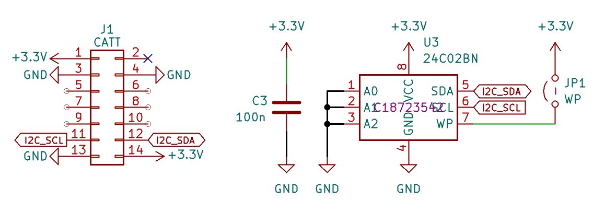
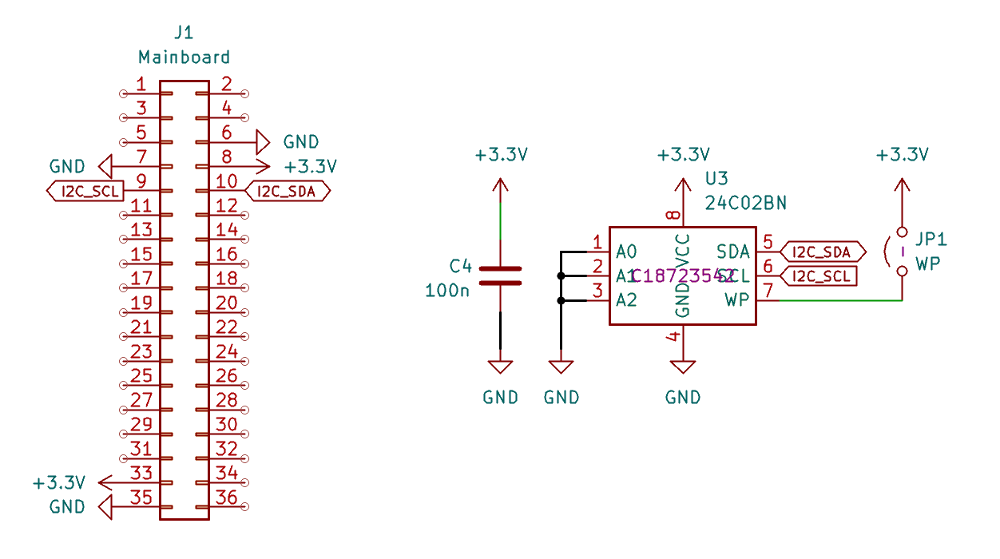

# Add-on identification

Tanmatsu supports two types of add-on boards: boards connected to the [external 'CATT' add-on port](hardware/connectors/external-add-on-port/) and boards connected to the [internal add-on port](/hardware/connectors/internal-add-on-port/).

Both types of add-on boards can be automatically detected through the inclusion of a small `24C02` EEPROM.

Such an EEPROM stores 256 bytes of information, which Tanmatsu can use to identify the type of add-on board installed.

The three address lines (`A0`, `A1` and `A2`) of the EEPROM chip are pulled down to ground. This sets the address of the EEPROM chip on the I2C bus to `0x50`.

## Reference schematic for CATT add-on boards

## Reference schematic for internal add-on boards

